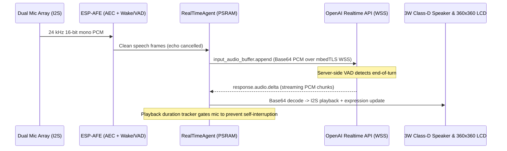

# ESP-VoCat Voice Assistant

[](https://github.com/eric-rolph/esp-vocat-voice-assistant/actions/workflows/ci.yml)
[](firmware/echoear_brookesia)
[-38bdf8)](firmware/echoear_brookesia/main/modules/agent_realtime.cpp)
[](LICENSE)

Direct-to-OpenAI **Realtime API** voice assistant running natively on an **ESP32-S3 (ESP-VoCat v1.2 / Echo Ear)** over TLS WebSocket — captures 24 kHz audio, streams directly to OpenAI with **no proxy server**, and plays back low-latency spoken responses with echo/self-interruption protection and circular display expressions.

---

## Real-Time Audio & Turn-Taking Pipeline



---

## Firmware Variants

| Directory | Framework | Status | When to Use |
|---|---|---|---|
| [`firmware/echoear_brookesia/`](firmware/echoear_brookesia/) | **ESP-IDF 5.5 + ESP-Brookesia** | **Active / Recommended** | Full direct-to-OpenAI Realtime WSS, PSRAM audio buffers, circular 360×360 UI, wake word (`"Hi, ESP"`), and SNTP TLS cert validation. |
| [`firmware/echoear_pio/`](firmware/echoear_pio/) | PlatformIO + Arduino | Experimental | Lightweight Arduino-framework port for rapid prototyping. |
| [`firmware/echoear_proxy/`](firmware/echoear_proxy/) | ESP-IDF | Legacy | Earlier proxy-based WebSocket client (superseded by direct WSS in `echoear_brookesia`). |
| [`server-micropython/`](server-micropython/) | Python | Optional Helper | Companion WebSocket relay used only with the legacy proxy firmware. |

---

## Hardware — ESP-VoCat v1.2

| Subsystem | Specification |
|---|---|
| **MCU Module** | ESP32-S3-WROOM-1-N16R16VA (16 MB Flash, 16 MB Octal PSRAM) |
| **Microphones** | Dual mic array (`LMA3729T381-OY3S`) for AEC, wake word & DOA |
| **Speaker** | 3 W speaker + integrated Class-D I2S amplifier |
| **Display** | 1.85" circular QSPI touchscreen (360×360, ST77916) |
| **Connectivity** | 2.4 GHz Wi-Fi 802.11 b/g/n + Bluetooth 5 LE, USB-C + 3.7 V Li-ion charger |
| **Audio Format** | 24 kHz, 16-bit signed mono PCM (bidirectional) |

> See the [official ESP-VoCat v1.2 User Guide](https://docs.espressif.com/projects/esp-dev-kits/en/latest/esp32s3/esp-vocat/user_guide_v1.2.html) for schematics and GPIO pin assignments, and [AGENTS.md](AGENTS.md) for AI-assisted firmware development notes.

---

## Quick Start (`echoear_brookesia`)

### Prerequisites
- **ESP-IDF v5.5**
- **ESP-VoCat v1.2** (or compatible ESP32-S3 with PSRAM + I2S audio)
- **OpenAI API key** with Realtime API access
- 2.4 GHz Wi-Fi network

### Build & Flash

```bash
git clone https://github.com/eric-rolph/esp-vocat-voice-assistant.git
cd esp-vocat-voice-assistant/firmware/echoear_brookesia

# Configure Wi-Fi, OpenAI API key, model & voice via menuconfig (stored in gitignored sdkconfig)
idf.py menuconfig

# Build & flash
idf.py build
idf.py -p COM4 flash

# Serial monitor
python -m serial.tools.miniterm COM4 115200 --raw
```

### Menuconfig Options

| Setting | Kconfig Key | Default |
|---|---|---|
| OpenAI API Key | `EXAMPLE_AGENTS_REALTIME_API_KEY` | *(required — never commit `sdkconfig`)* |
| Model | `EXAMPLE_AGENTS_REALTIME_MODEL` | `gpt-4o-realtime-preview` |
| Voice | `EXAMPLE_AGENTS_REALTIME_VOICE` | `alloy` |
| System Prompt | `EXAMPLE_AGENTS_REALTIME_SYSTEM_PROMPT` | Short IoT assistant |

---

## Project Structure

```text
esp-vocat-voice-assistant/
├── firmware/
│   ├── echoear_brookesia/    # Active ESP-IDF 5.5 + ESP-Brookesia direct-WSS firmware
│   ├── echoear_pio/          # PlatformIO / Arduino experimental port
│   └── echoear_proxy/        # Legacy proxy client
├── server-micropython/       # Optional legacy relay server
├── tools/pdm_diagnostics/    # PDM microphone test scripts
├── tests/                    # C++17 unit tests for audio Base64 framing
└── AGENTS.md                 # AI agent development guide
```

## License

MIT License — see [LICENSE](LICENSE).
